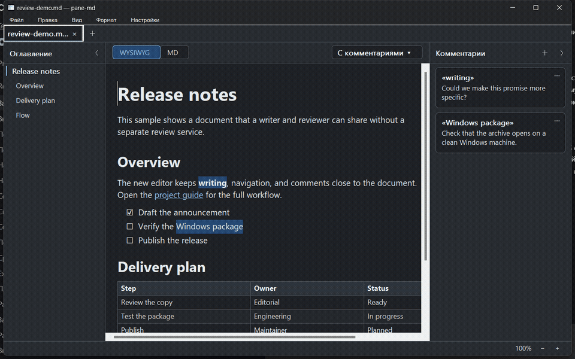
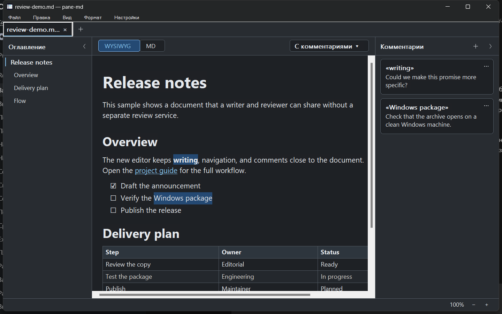
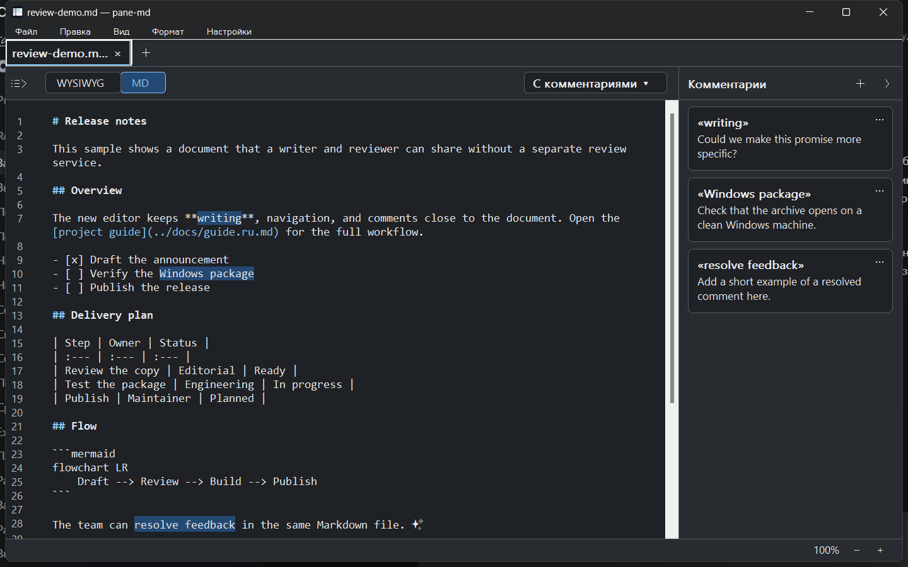
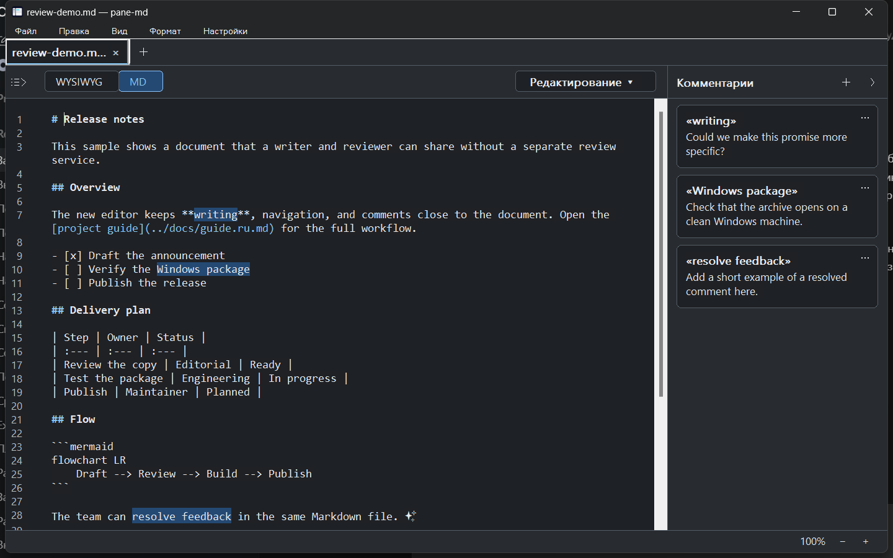

<p align="center"></p>

# pane-md

**A local Markdown editor for writing, reading, and reviewing documents.** It keeps comments in the Markdown file, so a person and an agent can work on the same document without a separate review service.

[Русский](README.ru.md) · [Detailed Russian guide](docs/guide.ru.md) · [Releases](https://github.com/letya999/pane-md/releases)

[](https://github.com/letya999/pane-md/actions/workflows/ci.yml) [](LICENSE) [](Cargo.toml)

## See it in action

<p align="center"></p>

<p align="center"><a href="docs/media/01-wysiwyg.png"></a> <a href="docs/media/02-source.png"></a> <a href="docs/media/03-editing.png"></a></p>

These are screenshots of the Windows app using the included [review demo](examples/review-demo.md). Select a thumbnail for the full-size image. The animated image cycles through the three views.

## What it does

- Opens files and folders in tabs, with a file explorer and collapsible outline.
- Switches between rendered WYSIWYG and Markdown source. Reading, reading with comments, and editing are separate modes.
- Renders headings, lists, tasks, tables, links, local images, emoji, and Mermaid diagrams. Remote images load only when requested.
- Attaches review cards to selected text, including table cells. Comments, edits, resolved state, and anchors stay in the `.md` file.
- Follows local files, heading anchors, and supported external links; provides search, replace, undo, and familiar keyboard shortcuts.
- Exposes a Markdown linter, comment reader, and a local STDIO MCP server for agent workflows.
- Supports English and Russian, light and dark themes, and appearance settings.

The Windows editor uses native RichEdit. Linux and macOS use the system WebView. Complex Markdown that cannot be safely changed in WYSIWYG remains available in source mode. Existing `notepad-md:review` comments and settings are read for migration.

## Download and run

Download the latest archive from [Releases](https://github.com/letya999/pane-md/releases). The Windows archive contains a portable `pane-md.exe` with an Explorer icon and version details; no installer or file association is required. Linux requires GTK 3, WebKitGTK 4.1, and an X11 or Wayland session. Its archive includes a `.desktop` launcher and icon for optional local installation. The macOS archive contains a universal `.app` with an ad hoc signature; it is not Developer ID signed or notarized.

On Linux, you can run `./pane-md` from the extracted archive. To add it to your application menu, ensure `~/.local/bin` is on your graphical session's `PATH`, then run:

```sh
install -Dm755 pane-md "$HOME/.local/bin/pane-md"
install -Dm644 pane-md.desktop "$HOME/.local/share/applications/pane-md.desktop"
install -Dm644 pane-md.png "$HOME/.local/share/icons/hicolor/1024x1024/apps/pane-md.png"
```

Open a document or a folder:

```text
pane-md path/to/document.md
pane-md path/to/folder
```

Use the **View** and **Format** menus for editor modes and formatting. Select text and press `Ctrl+Alt+M` to comment (`⌘` replaces `Ctrl` on macOS). `Ctrl+F` searches and `Ctrl+S` saves. See the [full guide](docs/guide.ru.md) for platform details and shortcuts.

## Build from source

Install Rust 1.95 or newer. Windows also needs Visual Studio Build Tools and the Windows SDK. Linux needs the GTK 3 and WebKitGTK 4.1 development packages; macOS needs Xcode Command Line Tools.

```sh
cargo build --release --locked
```

For the CLI and MCP server without GUI dependencies on Linux or macOS:

```sh
cargo build --release --locked --no-default-features
```

Packaging commands are `python scripts/package-windows.py`, `python3 scripts/package-linux.py`, and `python3 scripts/package-macos.py` on their respective systems. GitHub Actions builds archives for Windows x64, Linux x64, and macOS universal; a `vX.Y.Z` tag matching `Cargo.toml` publishes them with SHA-256 checksums. macOS GUI behavior still needs verification on a Mac.

## CLI and MCP

```text
pane-md --lint README.md
pane-md --lint --json README.md
pane-md --list-comments path/to/document.md
pane-md --source --wait path/to/document.md
pane-md --mcp
```

The MCP server uses standard input and output; diagnostic messages go to standard error. It offers `list_comments`, `lint_document`, and, in GUI builds, `open_document`. Relative paths are resolved from the server's working directory. A Codex CLI MCP entry can use the absolute executable path with `args = ["--mcp"]`.

## Contributing and security

Run `cargo fmt --all -- --check`, `cargo clippy --locked --all-targets -- -D warnings`, and `cargo test --locked --all-targets` before a pull request. See [CONTRIBUTING.md](.github/CONTRIBUTING.md), [AGENTS.md](AGENTS.md), the [code of conduct](.github/CODE_OF_CONDUCT.md), and the [changelog](docs/CHANGELOG.md). Report vulnerabilities privately as described in [SECURITY.md](.github/SECURITY.md).

Released packages include dependency notices and license copies. The pane-md source code and original icon are licensed under [MIT](LICENSE).
