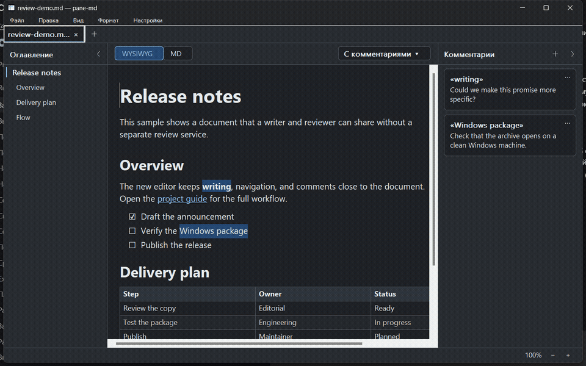
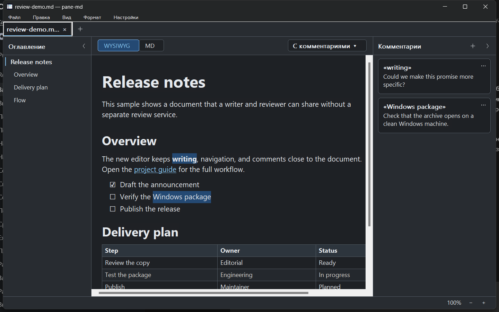
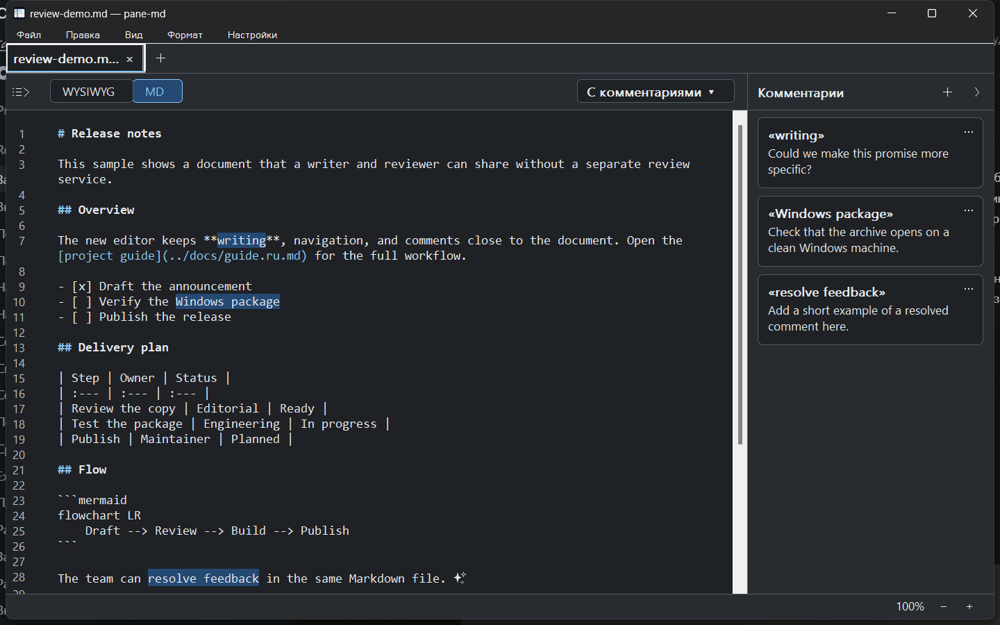
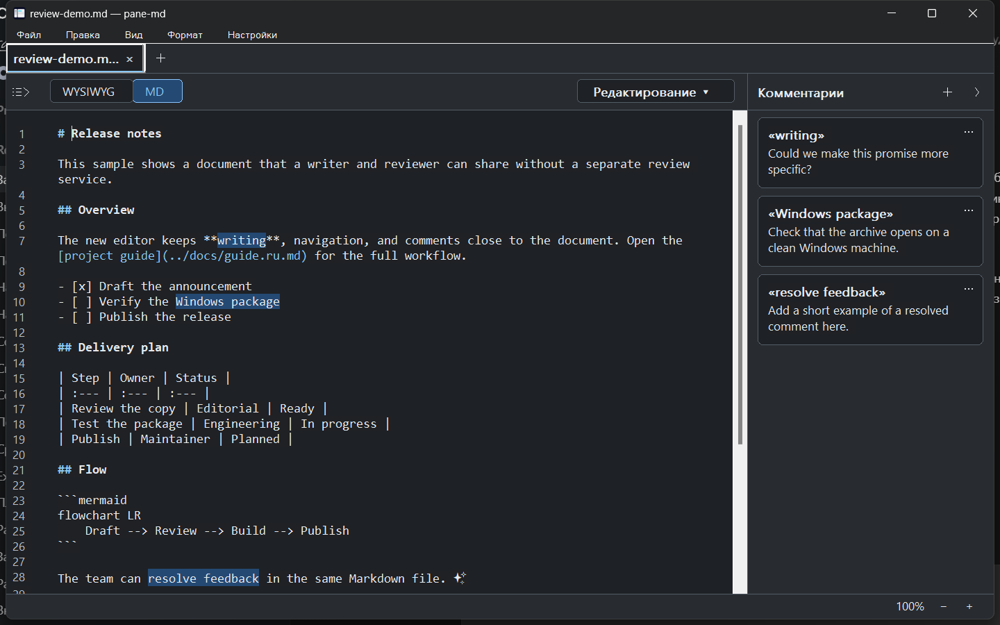

<p align="center"></p>

# pane-md

**Локальный редактор Markdown для чтения, правки и ревью документов.** Комментарии хранятся в самом Markdown-файле: человек и агент работают с одним документом без отдельного сервиса обсуждений.

[English](README.md) · [Подробное руководство](docs/guide.ru.md) · [Сборки](https://github.com/letya999/pane-md/releases)

[](https://github.com/letya999/pane-md/actions/workflows/ci.yml) [](LICENSE) [](Cargo.toml)

## Как выглядит приложение

<p align="center"></p>

<p align="center"><a href="docs/media/01-wysiwyg.png"></a> <a href="docs/media/02-source.png"></a> <a href="docs/media/03-editing.png"></a></p>

Это реальные кадры Windows-приложения с [демонстрационным документом](examples/review-demo.md). Нажмите на миниатюру, чтобы открыть полный размер. GIF по очереди показывает все три состояния.

## Возможности

- Открывает файлы и папки во вкладках; есть проводник и сворачиваемое оглавление.
- Переключает отрисованный WYSIWYG и исходный Markdown. Чтение, чтение с комментариями и редактирование — отдельные режимы.
- Показывает заголовки, списки, задачи, таблицы, ссылки, локальные картинки, эмодзи и диаграммы Mermaid. Сетевые изображения загружаются по запросу.
- Привязывает карточки комментариев к выделенному тексту, включая ячейки таблиц. Текст, статус и привязка остаются в `.md`.
- Переходит по локальным файлам, якорям заголовков и поддерживаемым внешним ссылкам; есть поиск, замена, отмена правок и горячие клавиши.
- Предоставляет линтер Markdown, чтение комментариев и локальный MCP-сервер по STDIO.
- Поддерживает русский и английский языки, светлую и тёмную темы, настройки оформления.

В Windows редактор использует нативный RichEdit; в Linux и macOS — системный WebView. Сложную разметку, которую нельзя безопасно изменить в WYSIWYG, можно править в исходнике. Старые записи `notepad-md:review` и настройки читаются для переноса.

## Скачать и запустить

Скачайте свежий архив на странице [Сборки](https://github.com/letya999/pane-md/releases). Windows-архив содержит переносимый `pane-md.exe` с иконкой и сведениями о версии в Проводнике; установщик и ассоциация файлов не нужны. В Linux требуются GTK 3, WebKitGTK 4.1 и сеанс X11 или Wayland. В архиве есть значок и файл `.desktop` для добавления в меню приложений. Архив macOS содержит универсальное `.app` с локальной подписью ad hoc; подписи Developer ID и нотариализации пока нет.

В Linux можно запустить `./pane-md` прямо из распакованного архива. Чтобы добавить приложение в меню, убедитесь, что `~/.local/bin` входит в `PATH` графического сеанса, затем выполните:

```sh
install -Dm755 pane-md "$HOME/.local/bin/pane-md"
install -Dm644 pane-md.desktop "$HOME/.local/share/applications/pane-md.desktop"
install -Dm644 pane-md.png "$HOME/.local/share/icons/hicolor/1024x1024/apps/pane-md.png"
```

Откройте документ или папку:

```text
pane-md путь/к/документу.md
pane-md путь/к/папке
```

Режимы и форматирование находятся в меню **Вид** и **Формат**. Выделите текст и нажмите `Ctrl+Alt+M`, чтобы добавить комментарий (на macOS вместо `Ctrl` используется `⌘`). `Ctrl+F` открывает поиск, `Ctrl+S` сохраняет. Подробности и сочетания клавиш — в [руководстве](docs/guide.ru.md).

## Сборка из исходников

Установите Rust 1.95 или новее. В Windows также нужны Visual Studio Build Tools и Windows SDK. В Linux — пакеты разработки GTK 3 и WebKitGTK 4.1; в macOS — Xcode Command Line Tools.

```sh
cargo build --release --locked
```

CLI и MCP без графических зависимостей на Linux или macOS:

```sh
cargo build --release --locked --no-default-features
```

Архивы создают `python scripts/package-windows.py`, `python3 scripts/package-linux.py` и `python3 scripts/package-macos.py` на соответствующих системах. GitHub Actions собирает Windows x64, Linux x64 и универсальное приложение macOS. Тег `vX.Y.Z`, совпадающий с версией в `Cargo.toml`, публикует архивы и SHA-256. Работу окна macOS ещё нужно проверить на Mac.

## CLI и MCP

```text
pane-md --lint README.md
pane-md --lint --json README.md
pane-md --list-comments путь/к/документу.md
pane-md --source --wait путь/к/документу.md
pane-md --mcp
```

MCP-сервер обменивается сообщениями через стандартный ввод и вывод; диагностика идёт в STDERR. Инструменты: `list_comments`, `lint_document` и, в графических сборках, `open_document`. Относительные пути считаются от рабочего каталога сервера. В конфигурации MCP для Codex CLI укажите абсолютный путь к EXE и `args = ["--mcp"]`.

## Участие и безопасность

Перед pull request выполните `cargo fmt --all -- --check`, `cargo clippy --locked --all-targets -- -D warnings` и `cargo test --locked --all-targets`. Порядок работы описан в [CONTRIBUTING.md](.github/CONTRIBUTING.md), правила для агентов — в [AGENTS.md](AGENTS.md). Также есть [правила сообщества](.github/CODE_OF_CONDUCT.md) и [история изменений](docs/CHANGELOG.md). Об уязвимостях сообщайте приватно по [SECURITY.md](.github/SECURITY.md).

В архивах есть уведомления и копии лицензий зависимостей. Исходный код pane-md и оригинальная иконка распространяются по [MIT](LICENSE).
