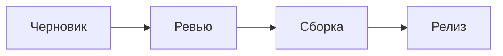

# План релиза

Markdown-файл: [Этапы](#этапы) · [Обсуждение](#обсуждение) · [Руководство](../docs/guide.ru.md) · [GitHub](https://github.com/letya999/pane-md/releases).

## Обзор

pane-md объединяет **редактирование**, оглавление и комментарии в одном документе. Ссылки ведут к заголовкам, соседним файлам и сайтам.

- [x] Подготовить содержание
- [ ] Проверить сборки
- [ ] Опубликовать релиз

## Этапы

| Шаг | Кто | Статус |
| :--- | :--- | :--- |
| Текст | Редактор | Готово |
| Проверка | Команда | В работе |
| Публикация | Мейнтейнер | Ожидает |

## Обсуждение

Замечания привязаны к тексту и сохраняются прямо в этом файле. После правки их можно закрыть без отдельного сервиса. ✨

## Схема процесса

<!-- pane-md:review {"v":1,"id":"demo-editing","quote":"редактирование","anchor":{"heading":"Обзор","block":"paragraph","prefix":"объединяет ","suffix":", оглавление"},"text":"Уточнить, что WYSIWYG и исходник сохраняют один файл.","status":"open"} -->
<!-- pane-md:review {"v":1,"id":"demo-builds","quote":"сборки","anchor":{"heading":"Обзор","block":"list","prefix":"Проверить ","suffix":""},"text":"Проверить запуск на чистой Windows.","status":"open"} -->
<!-- pane-md:review {"v":1,"id":"demo-notes","quote":"Markdown-файл","anchor":{"heading":"План релиза","block":"paragraph","prefix":"","suffix":":"},"text":"Закрыть после проверки ссылок и якорей.","status":"open"} -->
