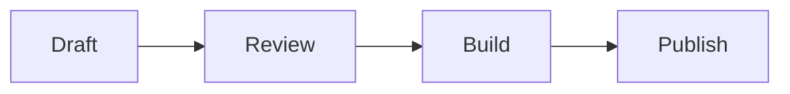

# Release notes

This sample shows a document that a writer and reviewer can share without a separate review service.

## Overview

The new editor keeps **writing**, navigation, and comments close to the document. Open the [project guide](../docs/guide.ru.md) for the full workflow.

- [x] Draft the announcement
- [ ] Verify the Windows package
- [ ] Publish the release

## Delivery plan

| Step | Owner | Status |
| :--- | :--- | :--- |
| Review the copy | Editorial | Ready |
| Test the package | Engineering | In progress |
| Publish | Maintainer | Planned |

## Flow

The team can resolve feedback in the same Markdown file. ✨

<!-- pane-md:review {"v":1,"id":"demo-copy","quote":"writing","anchor":{"heading":"Overview","block":"paragraph","prefix":"keeps ","suffix":", navigation"},"text":"Could we make this promise more specific?","status":"open"} -->
<!-- pane-md:review {"v":1,"id":"demo-package","quote":"Windows package","anchor":{"heading":"Overview","block":"list","prefix":"Verify the ","suffix":""},"text":"Check that the archive opens on a clean Windows machine.","status":"open"} -->
<!-- pane-md:review {"v":1,"id":"demo-flow","quote":"resolve feedback","anchor":{"heading":"Flow","block":"paragraph","prefix":"can ","suffix":" in the same"},"text":"Add a short example of a resolved comment here.","status":"open"} -->
